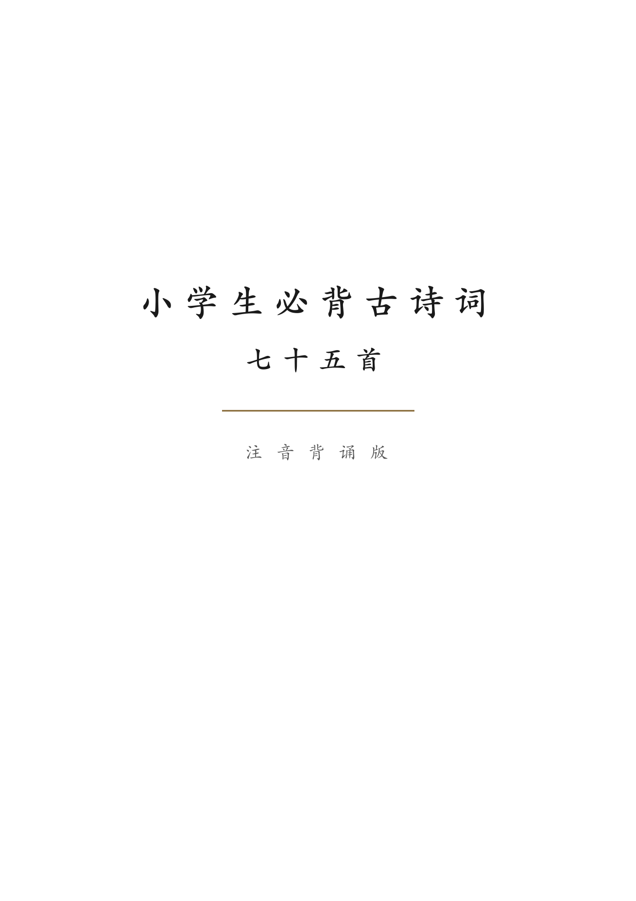
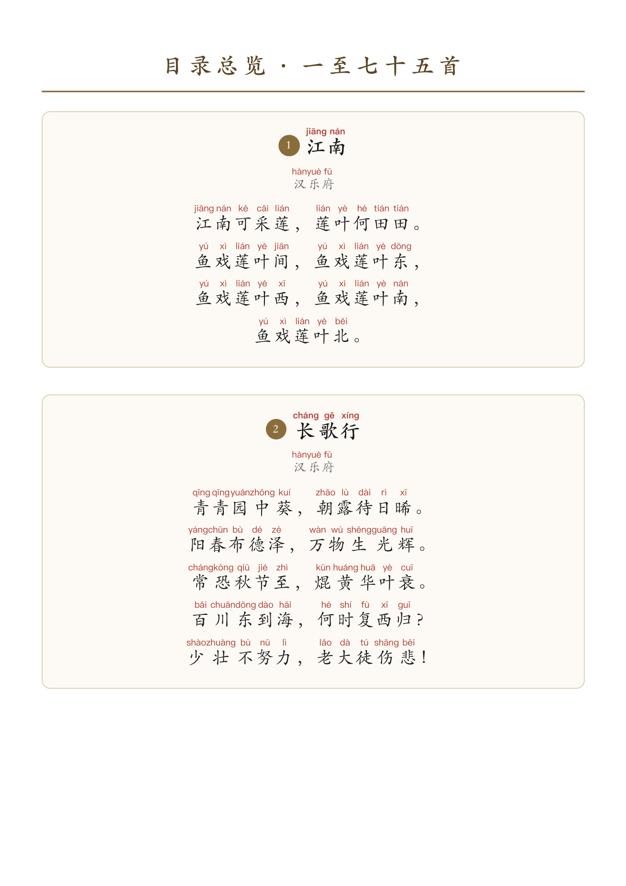

# 📚 小学生必背古诗词 75 首 · 拼音注音版

一套**可直接打印的高清 PDF**，收录《小学生必背古诗词 75 首》全文，并为每句诗词**逐字标注拼音**。所有多音字、通假字均按统编版小学语文教材的通行读音**逐字人工校对**，家长可以直接打印给小朋友背诵。

> 免安装、免登录、无广告，下载即用，打印不糊。

---

## ✨ 为什么值得一看

| 特性 | 说明 |
| --- | --- |
| 📖 收录完整 | 从《江南》《长歌行》到《己亥杂诗》，共 **75 首**，朝代、作者齐全 |
| 🔤 逐字注音 | 采用课文同款「字上标音」排版，拼音在每个汉字正上方 |
| ✅ 读音准确 | 多音字 / 通假字按教材标准**逐字人工校对**（见下方对照表） |
| 🖨️ 高清矢量 | A4 共 **27 页**，矢量文字，任意缩放、打印都清晰不模糊 |
| 🎨 楷体排版 | 正文楷体、拼音红棕色小字，贴近纸质课本版式 |
| 🕸️ 附带网页版 | 提供同名 `.html`，浏览器直接打开预览或投屏 |

---

## 📖 预览

| 封面 | 正文（第 1 首《江南》） |
| --- | --- |
|  |  |

---

## 📂 目录结构

```
.
├── 75首古诗-注音版.pdf          # ⭐ 成品：高清拼音注音 PDF（下载打印）
└── docs/                        # README 预览图
    ├── preview-cover.png
    └── preview-page-1.png
```

---

## 🚀 快速使用

**方式：直接用（推荐）**

直接下载 [`75首古诗-注音版.pdf`](./75首古诗-注音版.pdf)，A4 纸打印即可。


---

## ✅ 注音是如何保证准确的


| 诗句 | 正确注音 | 易错点 |
| --- | --- | --- |
| 风吹草低**见**牛羊 | xiàn | 通「现」，不是 jiàn |
| **鹿柴** | zhài | 地名，不读 chái |
| **单于**夜遁逃 | chán yú | 匈奴首领称号 |
| 乡音无改鬓毛**衰** | cuī | 减少、稀疏 |
| 草**长**莺飞二月天 | zhǎng | 生长，不是 cháng |
| 千磨万击还坚**劲** | jìng | 刚劲有力 |
| 四时田园杂**兴** | xìng | 即兴之作 |
| 京口瓜洲一水**间** | jiàn | 隔开 |
| 花**重**锦官城 | zhòng | 被雨沾湿而沉甸甸 |
| 问渠**那**得清如许 | nǎ | 通「哪」 |

> 另有「出塞 sài / 塞下曲 sài / 西塞山 sài」「朝露 zhāo / 南朝 cháo」「万重山 chóng / 花重 zhòng」等 50 余处，均在脚本 `FIX` 表中逐条注释、可查证。

---

## 📜 说明与许可

- 古诗词原文为古人作品，属公有领域；本仓库的**整理、校对与注音排版**为个人劳动成果。
- 仅供**学习交流、非商业使用**；欢迎转发分享，请注明出处。
- 部分字的读音在不同教材版本间存在差异（如「鬓毛衰」的 cuī/shuāi），本项目以**统编版通行读法**为准。

---

## ⭐ 支持一下

如果这份资料对你有帮助，欢迎：

- **点个 Star ⭐** —— 让更多人看到它
- **Fork 二次创作** —— 换字体、加插画、做更多篇目
- 发现读音或文字错误，提 **Issue / PR**，一起把它做得更准确

谢谢你的喜欢 ❤️
